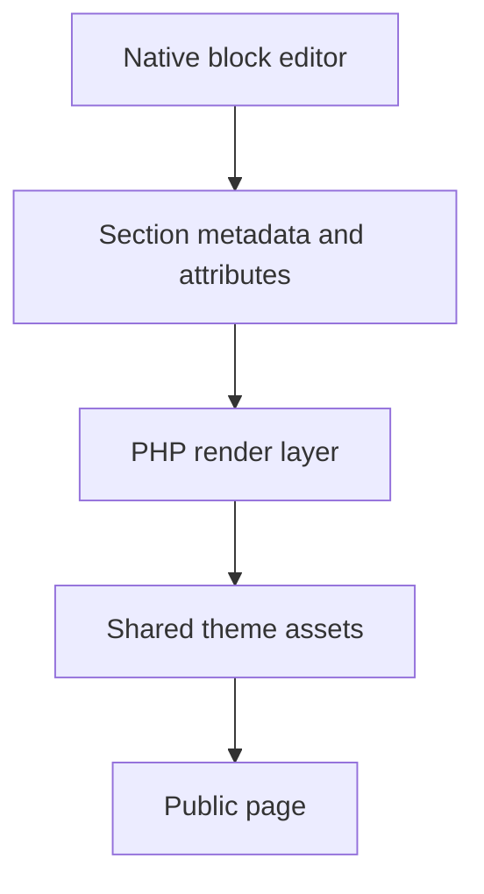

# Gutenberg Section Theme Framework

A section-based theme architecture that keeps page composition inside the native WordPress editor while separating rendering infrastructure from presentation code.

**Technical showcase · Documentation only · Anonymized**

WordPress | PHP | Gutenberg | JavaScript | CSS | Vite

## Engineering problem

Reusable sections need to stay editable without making every layout change a theme-code change. At the same time, shared content, legacy blocks and form integrations must coexist without turning the editor into a second frontend application.

## Implementation scope

- Organized section packages around block.json metadata, editor behavior and server-side rendering.
- Separated stable runtime code from the design layer and discovered section packages without a central hard-coded registry.
- Implemented reusable section variations with save, reuse, switch and detach workflows backed by native WordPress records.
- Kept legacy block compatibility at the boundary rather than making the current rendering path depend on the legacy field system.
- Integrated existing form providers and added structure, runtime, editor-safety and visual-contract checks.

## Architecture at a glance

The following is an illustrative technical flow, not a client screenshot or a deployment topology.

## Evidence and delivery boundary

Packaged implementation; this publication documents architecture, not a newly verified live deployment.

The inspected implementation includes a Vite build and separate structure, runtime, editor-safety, image and visual-contract checks. This showcase does not report a new execution of those private suites.

## Read more

- [Engineering decisions](docs/engineering.md)
- [Scope and evidence boundaries](docs/scope.md)

> This repository describes verified implementation work at a technical level. Original source, identities, business data and visual assets are intentionally omitted. It is not an installable application or a claim that the original private implementation is open source.
